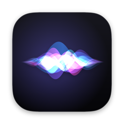
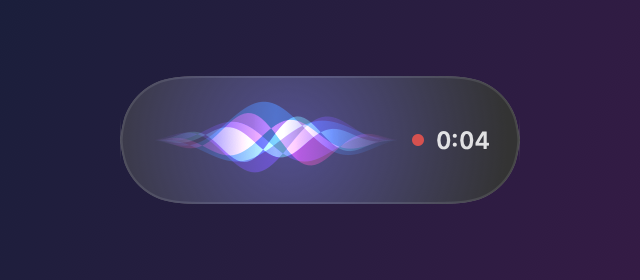
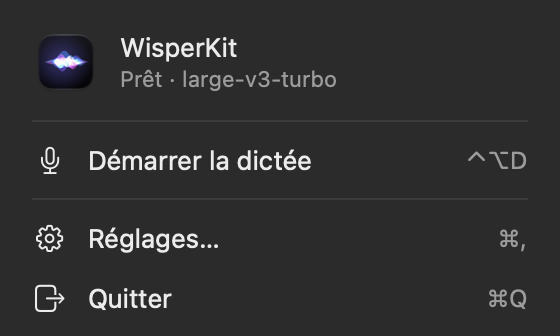
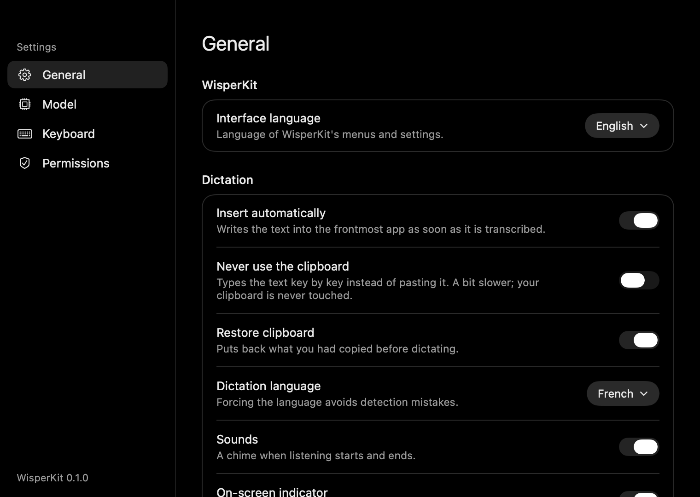
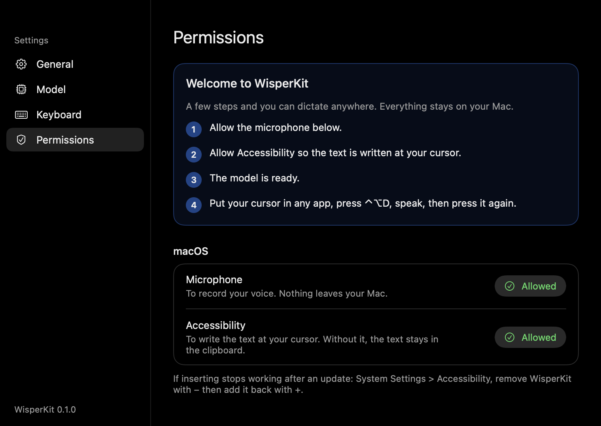

<div align="center">



# WisperKit

**Private, on-device dictation for macOS — press a shortcut, speak, and your words appear wherever your cursor is.**

[](https://github.com/eldriic/WisperKit/releases/latest)
[](https://github.com/eldriic/WisperKit/actions/workflows/ci.yml)


[](LICENSE)



[Install](#install) · [Usage](#usage) · [Privacy](#privacy) · [Troubleshooting](#troubleshooting) · [Build from source](#build-from-source) · [En français](#en-français)

</div>

---

WisperKit lives in your menu bar. Hit <kbd>⌃</kbd> <kbd>⌥</kbd> <kbd>D</kbd>, talk, hit it again: [OpenAI Whisper](https://github.com/openai/whisper) transcribes your voice **locally** on the Neural Engine (via [WhisperKit by Argmax](https://github.com/argmaxinc/WhisperKit)) and the text is typed straight into the app you were using — a chat with an AI assistant, an email, your editor, a terminal.

No account, no subscription, no audio ever leaves your Mac.

## Features

- **Dictate anywhere** — a global shortcut works in every app; the text is pasted at the cursor, and your clipboard is restored afterwards.
- **Fast and accurate** — `large-v3-turbo` runs on Apple Silicon and transcribes a few seconds of speech in about 1–3 s, with the model kept warm in memory.
- **Toggle or push-to-talk** — press once to start and once to stop, or hold the shortcut while you speak. <kbd>Esc</kbd> cancels.
- **Live indicator** — a small floating pill with waves that follow your voice, a timer while listening and a distinct state while transcribing.
- **Multiple models** — switch between `large-v3-turbo`, `large-v3`, `small` and `base` from the settings, downloads included.
- **Clipboard-free mode** — optionally types the text key by key so your clipboard is never touched (pasted text is also flagged so clipboard managers skip it).
- **English and French interface** — switch instantly in the settings.
- **Native and light** — SwiftUI menu bar app, no Dock icon, no Python, no Electron.

<p align="center">
  
  &nbsp;
  
</p>

## Install

Requirements: **macOS 15 Sequoia or later** on **Apple Silicon** (M1 or newer), ~2 GB of free disk space for the default model.

### Homebrew (recommended)

```bash
brew tap eldriic/tap
brew trust eldriic/tap        # Homebrew asks you to trust third-party taps once
brew install --cask wisperkit
```

Updates: `brew upgrade --cask wisperkit`.

### Manual download

1. Download `WisperKit-x.y.z.dmg` from the [latest release](https://github.com/eldriic/WisperKit/releases/latest).
2. Open it and drag **WisperKit** into **Applications**.
3. Launch WisperKit. Because the app is not notarized by Apple (see [why](#why-is-the-app-not-notarized)), macOS blocks the first launch:
   open **System Settings → Privacy & Security**, scroll down and click **Open Anyway** next to WisperKit, then confirm.

   Or, from a terminal:

   ```bash
   xattr -dr com.apple.quarantine /Applications/WisperKit.app
   ```

### First launch

A welcome window walks you through setup:

1. **Microphone** — allow it when macOS asks.
2. **Accessibility** — needed to type the text into other apps. Click **Open Settings** and enable WisperKit. Without it, WisperKit still works but only copies the text to your clipboard.
3. **Model** — `large-v3-turbo` (~1.6 GB) downloads once from Hugging Face; progress is shown in the menu.
4. Put your cursor anywhere, press <kbd>⌃</kbd> <kbd>⌥</kbd> <kbd>D</kbd>, speak, press it again. Done.

<p align="center"></p>

## Usage

| Action | Default |
| --- | --- |
| Start / stop dictation | <kbd>⌃</kbd> <kbd>⌥</kbd> <kbd>D</kbd> (change it in **Settings → Keyboard**) |
| Cancel while listening | <kbd>Esc</kbd> |
| Push-to-talk | **Settings → Keyboard → Mode → Hold** |
| Copy the last dictation | Menu bar → **Last dictation** |

Settings cover the interface language (English or French), auto-insert, clipboard-free typing, clipboard restore, dictation language (English, French or auto-detect), sounds, the on-screen indicator and launch at login.

### Models

| Model | Size | Best for |
| --- | --- | --- |
| `large-v3-turbo` *(default)* | 1.6 GB | Best accuracy / speed trade-off |
| `large-v3` | 3 GB | Maximum accuracy, slower |
| `small` | 480 MB | Older or low-memory Macs |
| `base` | 140 MB | Quick tests |

Models are stored in `~/Library/Application Support/WisperKit/Models`.

## Privacy

- Audio is recorded in memory, transcribed on your Mac and discarded. Nothing is uploaded, logged or kept.
- The only network access is the one-time model download from [Hugging Face](https://huggingface.co/argmaxinc/whisperkit-coreml).
- No analytics, no telemetry, no account.

## Troubleshooting

<details>
<summary><b>The text is copied but not pasted into the app</b></summary>

WisperKit needs the **Accessibility** permission to type into other apps, and macOS sometimes keeps a stale entry after an update. Reset it:

```bash
tccutil reset Accessibility com.eldriic.wisperkit
tccutil reset PostEvent com.eldriic.wisperkit
```

Then relaunch WisperKit and enable it again from **Settings → Permissions**.
A diagnostic log is written to `~/Library/Logs/WisperKit/wisperkit.log` (`envoiTouches=` / `axTrusted=` show the permission state at each dictation).

</details>

<details>
<summary><b>Nothing happens when I press the shortcut</b></summary>

Check the menu bar icon: the model may still be downloading or loading. Another app may also use <kbd>⌃</kbd> <kbd>⌥</kbd> <kbd>D</kbd> — pick another shortcut in **Settings → Keyboard**.

</details>

<details>
<summary><b>Some words are wrong</b></summary>

Force the language in **Settings → General → Dictation language** instead of auto-detect, and prefer `large-v3-turbo` or `large-v3`. A good microphone close to your mouth helps a lot.

</details>

<details>
<summary><b id="why-is-the-app-not-notarized">Why is the app not notarized?</b></summary>

Notarization requires a paid Apple Developer account. WisperKit releases are signed with a stable self-signed certificate instead: Gatekeeper asks for confirmation once, and macOS keeps your permissions across updates. The Homebrew cask removes the quarantine flag for you.

</details>

## Build from source

Requires Xcode 16+ and [XcodeGen](https://github.com/yonaskolb/XcodeGen) (`brew install xcodegen`).

```bash
git clone https://github.com/eldriic/WisperKit.git && cd WisperKit
swift test                     # core tests
./Scripts/build.sh --install   # builds WisperKit.app and installs it into /Applications
```

`build.sh` signs with a local code-signing certificate named **WisperKit Dev** if one exists in your keychain (otherwise ad-hoc). A stable signature lets macOS keep the Accessibility permission between builds; with ad-hoc signing you'll have to grant it again after each build.

<details>
<summary>Project layout</summary>

```
Sources/WisperKitCore/   Audio capture, Whisper transcription, dictation state machine, text insertion
App/WisperKit/           SwiftUI menu bar app, settings window, recording indicator
Tests/                   Swift Testing suites (WK_INTEGRATION=1 runs a real transcription)
Scripts/                 build.sh (build/install) and release.sh (DMG + Homebrew cask)
Casks/                   Homebrew cask template
```

Debug builds also accept `--snapshots <dir>` (renders every screen to PNG) and `--selftest <seconds> [--paste <bundle id>]` (microphone → model → clipboard, end to end).

</details>

## Contributing

Issues and pull requests are welcome — bug reports, new translations (add a `<lang>.lproj/Localizable.strings`), new features. Please run `swift test` before opening a PR.

## About this project

WisperKit was **vibe-coded**: designed and built through conversation with an AI coding assistant, then tested on a real Mac. The code is reviewed and covered by tests, but treat it as a personal tool shared in the open rather than a polished commercial product.

## Credits

- [Whisper](https://github.com/openai/whisper) by OpenAI — speech recognition models (MIT)
- [WhisperKit](https://github.com/argmaxinc/WhisperKit) by Argmax — Core ML inference on Apple Silicon (MIT)
- [KeyboardShortcuts](https://github.com/sindresorhus/KeyboardShortcuts) by Sindre Sorhus — global shortcut recorder (MIT)

## License

[MIT](LICENSE) © 2026 eldriic

---

## En français

**WisperKit** est une app de dictée pour macOS, 100 % locale : un raccourci (<kbd>⌃</kbd> <kbd>⌥</kbd> <kbd>D</kbd>), tu parles, et le texte s'écrit tout seul là où se trouve ton curseur. La transcription utilise Whisper sur la puce de ton Mac : aucun son ne quitte l'ordinateur.

**Installation** : `brew tap eldriic/tap && brew trust eldriic/tap && brew install --cask wisperkit`, ou télécharge le DMG de la [dernière version](https://github.com/eldriic/WisperKit/releases/latest), glisse l'app dans Applications, puis au premier lancement va dans **Réglages Système → Confidentialité et sécurité → Ouvrir quand même**. Une fenêtre d'accueil te guide ensuite : micro, Accessibilité (pour écrire au curseur), téléchargement du modèle (~1,6 Go, une seule fois). L'interface est en anglais par défaut : passe-la en français dans **Settings → General → Interface language**.

Projet *vibe-codé* (construit en dialoguant avec un assistant de code IA), partagé tel quel sous licence MIT.
